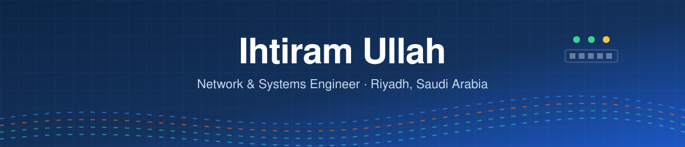

<!-- Header -->

  

  

  
  
  
  
   
  
  
  
  

  <a href="#-profile">Profile</a> ·
  <a href="#-career-path">Career Path</a> ·
  <a href="#%EF%B8%8F-skills">Skills</a> ·
  <a href="#-project--contract-experience">Projects</a> ·
  <a href="#%EF%B8%8F-employment-history">Employment</a> ·
  <a href="#-certifications--training">Certifications</a> ·
  <a href="#-education">Education</a> ·
  <a href="#-lets-connect">Contact</a>

## 👤 Profile

**Network & Systems Engineer** with **5 years** of hands-on experience designing, stabilizing and monitoring enterprise infrastructure across **Saudi Arabia** and **Pakistan** — from a 24/7 NOC, through enterprise networks and Windows estates, to carrier IP-core and AI data-centre deployments.

Repeatedly trusted to take ownership of **undocumented, production-critical networks** and turn them into fully documented, monitored, high-availability environments — including Zabbix monitoring that **cut alert noise by ~40%**. Comfortable owning complex environments end to end, diagnosing faults quickly under real operational pressure, and documenting systems so they stay maintainable after handover.

  

📚 **Now:** freelance data-centre field engineering in Riyadh, and preparing for the **CCNP ENCOR 350-401** exam.

## 🧭 Career Path

  

## 🛠️ Skills

<table>
<tr>
<td width="50%" valign="top">

**🌐 Network Infrastructure**
- Cisco routing & switching — Catalyst 2960 / 3560 / 3750 / 4500 / 4510
- Huawei enterprise — CloudEngine, eKitEngine, AirEngine WAC
- VLANs, trunking, inter-VLAN routing, STP, EtherChannel
- LAN / WAN design, operations & advanced troubleshooting

</td>
<td width="50%" valign="top">

**🖥️ Systems & Virtualization**
- Windows Server 2019 / 2022 — Active Directory, DNS, DHCP, GPO
- VMware ESXi & vCenter — lifecycle, vMotion, snapshots
- Backup, recovery & patch management
- EVE-NG — network simulation & lab testing

</td>
</tr>
<tr>
<td width="50%" valign="top">

**🔐 Security & Monitoring**
- Huawei USG6000E NGFW — security policy, NAT / PAT, IPsec VPN
- pfSense — ACLs, NAT, VPN, traffic logging
- Site-to-site & remote-access IPsec VPNs
- Zabbix — SNMP templates, PoE monitoring, alert-noise reduction

</td>
<td width="50%" valign="top">

**🏭 Data Centre & Field Deployment**
- Carrier IP core — ZTE M6000 routers, ZXR10 5950 / 5960, R5300 G5
- AI compute racks — receiving, positioning, grounding, A/B PDU feeds
- Structured cabling & fibre — MPO/MTP trunks, LC OM4, ODF
- Optics SFP+ / SFP28 / QSFP28 · −48 V DC power & PDUs · bench testing

</td>
</tr>
<tr>
<td width="50%" valign="top">

**🧰 Operations & Support**
- ITIL-aligned incident, problem & change management
- Root cause analysis · L1 / L2 / L3 technical support
- Technical documentation & runbook development
- Vendor, ISP & third-party coordination

</td>
<td width="50%" valign="top">

**🏢 Infrastructure, BMS & Field Systems**
- Enterprise Wi-Fi — controller-based, CAPWAP, Option 43
- IP surveillance — DVR / NVR, 230+ cameras (Hikvision)
- BMS controls — Schneider SpaceLogic, Trend IQeco, RS-485
- ICT / ELV — IPTV, AV, Crestron / KNX, access control · POS (Posiflex, Zebra, mada)

</td>
</tr>
</table>

## 🚀 Project & Contract Experience

> Newest first.

### 🛰️ Network Engineer · Viasat IGW Cabinet Build
    
center3 data hall · via RADX Global Services for ITARMI · client INS Group

- Two-engineer build of a **Viasat internet-gateway (IGW) cabinet** in a center3 data hall
- Started with no project documents — **requested and assembled** the device list, cable schedule, label sheet and labelling guide, front elevation, serial / MAC sheet and site contact before installing anything
- Absorbed a late client change: a device moved to **rear U45**, with new labels and an updated elevation
- Caught a **connector mismatch** on the terminal-server console cables (**RJ12, not RJ45**, at the PDU end) and left them unterminated pending the right part instead of forcing a fit
- Data-centre access, work permits and approvals handled with center3

### 🧠 Networking Level 2 Field Engineer · SambaNova AI Rack Deployment
    
center3 data hall · via RADX Global Services for ITARMI · for stc

- Part of a four-engineer team deploying **five 42U AI racks** for stc — one Core Services Rack and four **SambaNova SN40L-16** accelerator racks (~520 kg each)
- Received, inspected, uncrated, moved and positioned the racks; **grounding and A/B PDU feeds**
- Installed **two Fortinet FortiGate 200G** firewalls in the Core Services Rack before roll-in, with internal cabling
- Landed homerun **console, management and data cabling**; patch panel and NAP uplinks; console support during firewall bring-up; PDU power-on
- Cleared a missing site-access permit on day one by contacting center3 and stc directly, so the team could start

### 🏢 BMS Controls & Low Current Engineer · ANMAT Operations
    
Ministry of Tourism Project · occupied government building

- Retrofitted **Trend IQeco VAV controllers to Schneider SpaceLogic RP-V** inside an occupied government building, on night shifts
- **Cat 6A** terminations and **RS-485 field-bus loops** (around five controllers per segment)
- Prepared field devices for integration into the central BMS
- Site permits and coordination, as-installed records, and the crew timesheet

### 📡 Data Center Deployment Engineer · Leon Technology
    
GO Telecom — GO-ZTE IPCORE Project · national 63-site rollout

- Deployed carrier-grade IP-core infrastructure on a **national 63-site rollout** for GO Telecom, hands-on at **RIY1** and other Riyadh data-centre sites
- Full rack builds of **ZTE M6000-4SE / M6000-3S Plus** core and PE routers, **ZXR10 5950 / 5960** access and NNI switches, and **R5300 G5** server nodes
- Structured fibre and copper — **MPO/MTP trunks, LC OM4** jumpers, inter-rack runs and **ODF** termination — to carrier installation standards
- Installed and validated **SFP+, SFP28 and QSFP28** optics; DC power cabling and PDU installation
- Equipment receipt, **iEPMS** material scanning and bench testing before install, ready for ZTE commissioning teams

### 🏛️ ICT Maintenance Engineer · MAMCO
    
Multi-building private estate · eleven ICT / ELV systems

- Maintained the complete **ICT / ELV estate** of a multi-building private estate: networking, IPTV, audio-visual, Crestron / KNX control, IP surveillance, access control and intercom
- Compiled an **End-of-Life register of 78 ICT / ELV devices** — model, lifecycle status and replacement planning
- Built the estate's full **technical document library** (datasheets, manuals, as-builts) and reviewed contractor handover documents, closing the gaps
- Identified devices needing configuration backups and set up **backup and version-control practice** for critical systems

### 🖧 IT Infrastructure Engineer · UCT
    
Two-office SMB network & domain deployment · solo delivery

- Delivered a complete two-office IT infrastructure end to end: design, implementation and handover
- **Windows Server 2022 AD DS** (domain uct.local) with DNS, DHCP, Group Policy and NTFS-secured shared folders
- Engineered a **point-to-point wireless bridge** (TP-Link / Huawei) joining both offices into one routed network
- Full configuration documentation and on-site staff training for day-two operations

## 🏗️ Employment History

### IT Engineer · Wemart Arabia Trading Co. L.L.C (WenChao Group)
    
Multi-site retail & warehouse enterprise · WenChao Group

- Took full ownership of a live, **undocumented** enterprise environment and built end-to-end visibility across multi-site retail operations from scratch
- Managed the Huawei stack: **CloudEngine** core, **eKitEngine** access, **AirEngine WAC** and **USG6000E** NGFW
- Designed and maintained the **IPsec VPN to Dubai HQ** over Zain fibre, with full NAT / PAT and firewall policy management
- Resolved critical production issues — **asymmetric routing** (CCTV network), **DHCP pool exhaustion** and **ARP conflicts** — with zero service downtime
- Engineered **Zabbix** monitoring (Huawei SNMP, PoE discovery, config tracking, device alerts), cutting alert noise by **40%**
- Stabilized enterprise wireless (**50+ APs**), resolving CAPWAP, Option 43 and controller-uplink issues
- Managed POS and retail systems (Posiflex, Zebra, mada) and **230+ camera** Hikvision CCTV
- Maintained full documentation: topology diagrams, IP schema, VLAN maps and runbooks

### Network Engineer · AlmavivA Information Technology
    
Riyadh Metro transport project · stations and depots

- Delivered network operations across **multiple stations and depots**, consistently meeting SLA targets
- Configured and maintained the **Cisco Catalyst 4510** core: VLAN segmentation, STP optimization, EtherChannel, inter-VLAN routing
- Administered **VMware vCenter & ESXi**: lifecycle management, live migrations, patching, capacity planning, backup and snapshots
- Deployed and supported IP telephony, wireless networks, CCTV and physical access control
- Configured **MOXA wireless bridges** and performed **RF surveys and VSWR testing** on field communication links
- Implemented site-to-site and remote-access **IPsec VPNs** across distributed locations
- Monitored performance via **NMS**, analyzed KPIs and SLA metrics, and drove root-cause remediation
- Maintained runbooks and configuration backups; followed ITIL change, incident and problem processes

### System Support Engineer · Express Publications (Pvt.) Ltd.
    
Media house · multi-floor office · 100+ endpoints

- Configured and maintained **Cisco routing and switching** — VLANs, trunking and inter-VLAN routing across a multi-floor office
- Administered **Windows Server** for **100+ endpoints**: Active Directory, DNS, DHCP and Group Policy
- Managed **pfSense** firewall operations: NAT, VPN tunnels, access-control policy and traffic monitoring
- Data protection and endpoint security with **Veeam Backup** and **Kaspersky Security Center**
- Maintained **VMware ESXi** environments: VM provisioning, patching and snapshot-based backups
- L1 / L2 technical support and system deployments with minimal downtime

### NOC Engineer (Promoted from Trainee) · Veevo Tech (Pvt.) Ltd.
    
24/7 Network Operations Centre · promoted from trainee

- Monitored servers, switches and routers in a **24/7 NOC**, meeting SLA targets
- Remote diagnostics over **SSH and console**; triaged incidents and restored services with full ticket documentation
- Configured and supported VLANs, trunking, inter-VLAN routing and DHCP
- Proactive **Zabbix** monitoring of interface errors, uptime, discards and device health; severity-based escalation
- Coordinated with ISPs and field engineers for link turn-ups, site cutovers and last-mile faults
- Maintained runbooks, configuration backups and change logs; produced capacity and performance reports

## 📜 Certifications & Training

| | Certification / Course | Issuer | Year | Status |
|---|---|---|---|---|
|  | **CCNA 200-301** | Cisco · Corvit Systems | 2021 | ✅ Certified |
|  | **CCNP ENCOR 350-401** | Cisco · Corvit Systems | 2022 | 📚 Training complete — exam in preparation |
| 🔄 | **ITIL 4 Foundation** | — | 2022 | 📚 Training complete |
| 🖥️ | **CompTIA A+** | CompTIA · Corvit Systems | 2021 | ✅ Certified |
|  | CCNP Enterprise ENARSI 300-410 | Corvit Systems | 2022 | 📚 Training complete |
| 🪟 | Windows Server 2022 Administration (MCSE track) | Corvit Systems | 2022 | 📚 Training complete |
| ☁️ | Microsoft Azure Administrator (AZ-104) | Corvit Systems | 2023 | 📚 Training complete |
| 📹 | CCTV Operator | Corvit Systems | 2023 | 📚 Training complete |
|  | VMware ESXi & vCenter Administration | Udemy | 2024 | 📚 Training complete |

## 🎓 Education

**Bachelor of Information Technology** — The University of Agriculture, Peshawar 
May 2019 – Aug 2023 · **CGPA 3.33 / 4.00** 
Key subjects: Network Security · Computer Networks · Database Systems 
Final year project: **MPLS VPN Design & Simulation**

## 🌍 Languages

| English | Urdu | Hindi | Arabic |
|---|---|---|---|
| Highly proficient | Native | Native | Working knowledge |

## 🎥 @gulf_networking

I teach networking from the field to **35K+ followers** — real fibre, SFP and data-centre work, RJ45 pinouts, OSI, and CCNA / CCNP prep, made with my own field photos and a Python + FFmpeg rendering pipeline. Playlists include **Fiber & SFP**, **Data Center** and **Real field work**.

  

  
  

## 🏏 Outside Work

Early-morning routines & discipline · Cricket · Landscape photography & photo editing · Nature trips & hiking

## 📫 Let's Connect

Open to **Network**, **Systems**, **Data Centre** and **Infrastructure** roles across Saudi Arabia — full-time or contract.

| | |
|---|---|
| 📧 Email | [ihtirammmd01@gmail.com](mailto:ihtirammmd01@gmail.com) |
| 📱 Phone / WhatsApp | +966 50 881 7993 |
| 💼 LinkedIn | [linkedin.com/in/ihtiram-ullah-1978532a8](https://www.linkedin.com/in/ihtiram-ullah-1978532a8) |
| 📍 Location | Riyadh, Saudi Arabia · Pakistani · Transferable Iqama · Available immediately · Open to relocation across KSA |
| 🤝 References | Available on request |

  

